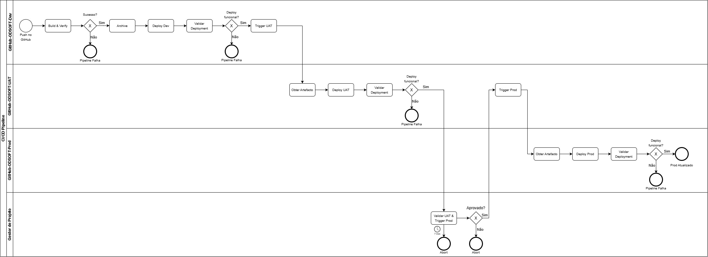
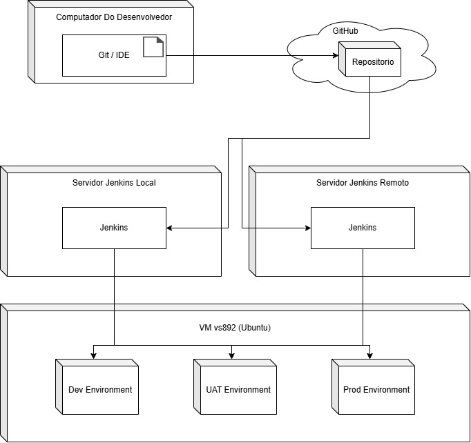
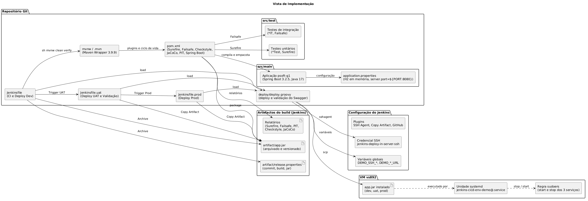

# Análise do Sistema To-Be

Este documento descreve o estado alvo do sistema, com base no diagnóstico apresentado em [System_As_Is_Analisys.md](System_As_Is_Analisys.md). Define os reajustes nos testes, a pipeline a criar e os diagramas da solução implementada, e regista ainda as decisões tomadas e a rastreabilidade entre requisitos, artefactos e evidências.

## 1. Reajustes nos testes

### 1.1 Reorganização dos testes

A convenção de nomes distingue os testes unitários, cujas classes terminam em `Test`, dos testes de integração, cujas classes terminam em `IT`. As 14 classes unitárias já cumprem a convenção e mantêm o nome. As 7 classes de integração, que usam os sufixos `IntegrationTest`, `Test` e `Tests` ou o prefixo `Test`, serão renomeadas. O subconjunto de testes unitários sobre o qual serão executados os testes de mutação será definido na secção 1.3.

| Classe de teste atual | Classe de teste após reorganização | Categoria (`*Test`, `*IT`, mutação) |
|---|---|---|
| `AuthorTest` | `AuthorTest` (sem alteração) | `*Test` e mutação |
| `BioTest` | `BioTest` (sem alteração) | `*Test` e mutação |
| `BookTest` | `BookTest` (sem alteração) | `*Test` |
| `DescriptionTest` | `DescriptionTest` (sem alteração) | `*Test` |
| `IsbnTest` | `IsbnTest` (sem alteração) | `*Test` |
| `TitleTest` | `TitleTest` (sem alteração) | `*Test` |
| `GenreTest` | `GenreTest` (sem alteração) | `*Test` |
| `LendingNumberTest` | `LendingNumberTest` (sem alteração) | `*Test` |
| `LendingTest` | `LendingTest` (sem alteração) | `*Test` |
| `BirthDateTest` | `BirthDateTest` (sem alteração) | `*Test` |
| `PhoneNumberTest` | `PhoneNumberTest` (sem alteração) | `*Test` |
| `ReaderTest` | `ReaderTest` (sem alteração) | `*Test` |
| `NameTest` | `NameTest` (sem alteração) | `*Test` |
| `PhotoTest` | `PhotoTest` (sem alteração) | `*Test` |
| `PsoftG1ApplicationTests` | `PsoftG1ApplicationIT` | `*IT` |
| `AuthorRepositoryIntegrationTest` | `AuthorRepositoryIT` | `*IT` |
| `AuthorServiceImplIntegrationTest` | `AuthorServiceImplIT` | `*IT` |
| `LendingRepositoryIntegrationTest` | `LendingRepositoryIT` | `*IT` |
| `LendingServiceImplTest` | `LendingServiceImplIT` | `*IT` |
| `AuthorControllerIntegrationTest` | `AuthorControllerIT` | `*IT` |
| `TestAuthApi` | `AuthApiIT` | `*IT` |

A execução dos dois grupos de testes será separada no `pom.xml`. O `maven-surefire-plugin` executará na fase `test` apenas as classes `**/*Test.java` e excluirá as classes `**/*IT.java`. O `maven-failsafe-plugin` executará na fase `integration-test` as classes `**/*IT.java`, com os objetivos `integration-test` e `verify`. O Failsafe usará o diretório `${project.build.outputDirectory}` como `classesDirectory`, porque o `spring-boot-maven-plugin` reempacota o jar e as classes de teste deixam de ser encontradas no artefacto.

| Comando | Plugin | Classes executadas | Testes | Resultado |
|---|---|---|---|---|
| `mvn test` | Surefire | 14 (`*Test`) | 89 | Sucesso |
| `mvn verify` | Surefire e Failsafe | 14 (`*Test`) e 5 (`*IT`) | 89 e 13 | Sucesso |

Os valores desta tabela refletem a suite imediatamente após a reorganização, antes da criação dos testes novos da secção 1.2.

### 1.2 Criação de novos testes (unitários e de integração)

Os testes criados concentrar-se-ão no domínio Autor (`authormanagement`) e na funcionalidade de atualização parcial de um autor, que atravessa o modelo (`Author.applyPatch`) e o serviço (`AuthorServiceImpl.partialUpdate`). Nenhum dos testes usará base de dados.

| Granularidade | Abordagem (caixa) | Mínimo exigido | Testes criados | Teste de exemplo |
|---|---|---|---|---|
| Unitário | Caixa opaca | 1 | 1 (`AuthorTest`) | `shouldUpdateNameAndBioWhenVersionMatches` |
| Unitário | Caixa transparente | 1 | 1 (`AuthorServiceImplTest`) | `shouldThrowNotFoundExceptionWhenAuthorDoesNotExist` |
| Integração | Caixa opaca | 1 | 1 (`AuthorServiceImplIT`) | `shouldReturnUpdatedAuthorWhenPartialUpdateHasOnlyName` |
| Integração | Caixa transparente | 1 | 1 (`AuthorServiceImplIT`) | `shouldNotSaveAuthorWhenVersionIsStale` |

O domínio Autor será escolhido por apresentar as camadas de modelo e de serviço com cobertura insuficiente no estado atual, nomeadamente o pacote `authormanagement.services`, com 13,2% de linhas e 0% de ramos cobertos, e por ser um domínio de dimensão reduzida, que dispensa a preparação de dados de outros domínios. Os nomes dos métodos seguirão o padrão `should...When...` e cada teste será organizado segundo o padrão Arrange, Act e Assert.

| Teste | SUT | Técnica de desenho | Doubles |
|---|---|---|---|
| `shouldUpdateNameAndBioWhenVersionMatches` | `Author.applyPatch` | Partições de equivalência, a partir do comportamento esperado | Nenhum |
| `shouldThrowNotFoundExceptionWhenAuthorDoesNotExist` | `AuthorServiceImpl.partialUpdate` | Cobertura de ramos, sobre a procura do autor | Mocks de `AuthorRepository`, `BookRepository`, `AuthorMapper` e `PhotoRepository` |
| `shouldReturnUpdatedAuthorWhenPartialUpdateHasOnlyName` | `AuthorService.partialUpdate`, usado pela interface | Partições de equivalência, verificando apenas o resultado devolvido | `@MockBean AuthorRepository` |
| `shouldNotSaveAuthorWhenVersionIsStale` | `AuthorService.partialUpdate`, com o `AuthorServiceImpl` e o `AuthorMapper` reais | Verificação da interação com o repositório, a partir da ordem interna das operações do serviço | `@MockBean AuthorRepository` |

Nos testes de caixa opaca, os casos derivam do comportamento esperado da funcionalidade e a verificação incide sobre o resultado devolvido. Nos testes de caixa transparente, os casos derivam da estrutura do código, e a verificação incide sobre um ramo interno ou sobre a interação com o repositório. Nos testes de integração, o contexto Spring monta o serviço e o mapper reais, e a persistência é substituída por um `@MockBean`.

Com os quatro testes novos, a execução da suite totalizará 91 testes unitários e 15 testes de integração.

| Comando | Plugin | Testes antes | Testes novos | Testes após | Resultado |
|---|---|---|---|---|---|
| `mvn test` | Surefire | 89 | 2 | 91 | Sucesso |
| `mvn verify` (fase `integration-test`) | Failsafe | 13 | 2 | 15 | Sucesso |

A cobertura global foi medida com o JaCoCo 0.8.12, sobre `mvn verify`, de modo a incluir os testes unitários e de integração, tal como na medição do diagnóstico inicial. O JaCoCo ficará configurado no `pom.xml`, com o agente associado à fase `initialize` e o relatório à fase `verify`, e o relatório será gerado em `target/site/jacoco`. O bundle analisado mantém as 139 classes.

| Indicador | As-Is (102 testes) | Após os testes novos (106 testes) | Variação |
|---|---|---|---|
| Cobertura de linhas | 19,5% (558 de 2868) | 20,3% (581 de 2868) | +23 linhas (+0,8 p.p.) |
| Cobertura de ramos | 4,5% (117 de 2579) | 4,8% (125 de 2579) | +8 ramos (+0,3 p.p.) |
| Cobertura de métodos | 18,1% (212 de 1174) | 19,1% (224 de 1174) | +12 métodos (+1,0 p.p.) |

#### Diretrizes de escrita dos testes

Os testes novos seguirão as diretrizes da tabela seguinte.

| Aspeto | Diretriz |
|---|---|
| Nome dos métodos | Padrão `should...When...`, por exemplo `shouldThrowNotFoundExceptionWhenAuthorDoesNotExist` |
| Estrutura de cada teste | Padrão Arrange, Act e Assert, com um comentário a assinalar cada fase (`// Arrange`, `// Act`, `// Assert`). Quando a ação e a verificação forem inseparáveis, como em `assertThrows`, será usado `// Act + Assert` |
| Documentação da classe | Comentário Javadoc com a granularidade, o SUT, a técnica e os doubles usados |
| Execução | O Surefire executará os testes unitários e o Failsafe os de integração, em etapas separadas da pipeline |

### 1.3 Criação de testes de mutação

Os testes de mutação serão executados com o PIT, que alterará o código de produção (mutantes) e verificará se os testes unitários detetam cada alteração. Não constituirão classes de teste novas: corresponderão a uma execução sobre um subconjunto dos testes unitários, o do domínio Autor.

| Elemento | Descrição |
|---|---|
| Ferramenta | PIT (`pitest-maven` 1.16.1, com `pitest-junit5-plugin` 1.2.1) |
| Subconjunto de testes unitários | `AuthorTest`, `BioTest` e `AuthorServiceImplTest` |
| Classes alvo | `authormanagement.model.*` e `authormanagement.services.AuthorServiceImpl` |
| Configuração (ficheiro e opções) | `pom.xml`, plugin `pitest-maven` com `targetClasses`, `targetTests`, relatórios HTML e XML e `timestampedReports` desativado, e a execução `mutation-coverage` associada à fase `verify` |
| Forma de execução (local e pipeline) | Local e pipeline: `mvn clean verify`, que executa o PIT na fase `verify`. Execução isolada: `mvn test-compile org.pitest:pitest-maven:mutationCoverage`. Na pipeline corre no estágio `Build & Verify` (secção 2.2) |

O plugin estará associado à fase `verify` do Maven, depois dos testes de integração, pelo que não será executado em `mvn test`, mas será executado em `mvn verify`. O relatório será gerado em `target/pit-reports`. O subconjunto restringir-se-á ao domínio Autor para manter a execução curta e coerente com os testes da secção 1.2. Não serão definidos valores mínimos para o mutation score nem para o test strength.

Inicialmente não existiam testes de mutação no projeto (ver a secção 7 do As-Is), pelo que não há uma medição anterior para comparar. Os valores da linha "Após os reajustes" são a primeira medição do PIT.

| Momento | Testes ativos | Cobertura de linhas | Mutation score | Test strength |
|---|---|---|---|---|
| Baseline (As-Is) | Não existia | Não existia | Não existia | Não existia |
| Após os reajustes | 16 | 49% (37/75) | 33% (16/49) | 80% |

Os valores da linha "Após os reajustes" resultam da execução do PIT sobre os três testes do subconjunto (`AuthorTest`, `BioTest` e `AuthorServiceImplTest`) e as classes alvo. A cobertura de linhas refere-se apenas às classes mutadas e o número de testes ativos foi inferido a partir das contagens por classe (10, 5 e 1).

| Indicador do PIT | Valor |
|---|---|
| Mutantes gerados | 49 |
| Mutantes mortos | 16 (33%) |
| Mutantes sobreviventes | 4 |
| Mutantes sem cobertura | 29 |
| Test strength | 80% |
| Execuções de testes | 39 |
| Duração da análise | 20 segundos |

| Mutador | Gerados | Mortos | Sobreviventes | Sem cobertura |
|---|---|---|---|---|
| `ConditionalsBoundaryMutator` | 1 | 0 | 1 | 0 |
| `VoidMethodCallMutator` | 15 | 6 | 0 | 9 |
| `NullReturnValsMutator` | 4 | 1 | 0 | 3 |
| `EmptyObjectReturnValsMutator` | 13 | 3 | 2 | 8 |
| `NegateConditionalsMutator` | 16 | 6 | 1 | 9 |

#### Análise dos mutantes sobreviventes e sem cobertura

Os 4 mutantes sobreviventes foram classificados a partir do relatório do PIT.

| Mutante | Classificação | Justificação |
|---|---|---|
| `AuthorServiceImpl.findByAuthorNumber`, linha 34 (`EmptyObjectReturnVals`) | Equivalente neste teste | O único teste unitário do serviço já faz o mock devolver um `Optional` vazio, pelo que o mutante tem o mesmo resultado |
| `Author.applyPatch`, linha 62 (`NegateConditionals`) | Relevante | A condição sobre `photoURI` não é exercitada, porque nenhum teste envia uma URI |
| `Author.getVersion`, linha 37 (`EmptyObjectReturnVals`) | Equivalente na prática | A versão inicial de um autor novo é 0, que coincide com o valor devolvido pelo mutante |
| `Bio.setBio`, linha 32 (`ConditionalsBoundary`) | Relevante | Nenhum teste verifica o limite de tamanho da bio |

Os 29 mutantes sem cobertura são consequência do desenho do PIT, que só executa o subconjunto unitário (`AuthorTest`, `BioTest` e `AuthorServiceImplTest`). O código que apenas os testes de integração exercitam fica fora da medição.

| Classe | Mutantes sem cobertura | Métodos |
|---|---|---|
| `AuthorServiceImpl` | 24 | `create` (7), `partialUpdate` (8), `removeAuthorPhoto` (4, incluindo a lambda), `findAll`, `findByName`, `findBooksByAuthorNumber`, `findCoAuthorsByAuthorNumber` e `findTopAuthorByLendings` (1 cada) |
| `Author` | 5 | `removePhoto` (2), `applyPatch`, `getAuthorNumber` e `getId` (1 cada) |

Para eliminar os sobreviventes relevantes seriam precisos testes novos (um com `photoURI` e um no limite de tamanho da bio). Como o mínimo definido para esta fase é de quatro testes, ficam registados como trabalho futuro (secção 2.9).

### 1.4 Análise estática (linter)

O diagnóstico inicial não encontrou nenhum linter configurado. Será usado o Checkstyle, através do `maven-checkstyle-plugin`, com as regras do Google.

| Elemento | Descrição |
|---|---|
| Ferramenta | Checkstyle (`maven-checkstyle-plugin` 3.3.1) |
| Regras | `google_checks.xml`, incluídas no plugin |
| Âmbito | Código de produção (`src/main/java`), sem os testes |
| Configuração (ficheiro e opções) | `pom.xml`, com `consoleOutput` ativo, `failOnViolation` ativo e `violationSeverity` igual a `error` |
| Fase do Maven | `validate`, com o objetivo `check` |
| Execução (local e pipeline) | Local e pipeline: `mvn clean verify`. Execução isolada: `mvn checkstyle:check`. Na pipeline corre no estágio `Build & Verify` (secção 2.2) |
| Relatório | `target/checkstyle-result.xml`, arquivado pela pipeline |

As regras do Google reportam as violações com gravidade de aviso, pelo que não farão falhar o build, e só uma violação de gravidade `error` o faria. A execução sobre o código atual encontrou 5876 avisos e 0 erros.

## 2. Criação da pipeline

A pipeline será implementada na plataforma Jenkins e dividida em três pipelines (jobs), definidas em três ficheiros versionados no repositório que partilham o script `deploy/deploy.groovy`. O pacote produzido pelo CI ficará arquivado e versionado no Jenkins, e será esse mesmo pacote a ser instalado em Dev, em UAT e em Produção. A pipeline será executada em dois contextos de execução do Jenkins, um local e um remoto (secção 2.6), que usam os mesmos Jenkinsfiles e fazem deploy nos mesmos ambientes.

### 2.1 Pipelines

| Job Jenkins | Ficheiro | Trigger | Estágios | Termina com |
|---|---|---|---|---|
| `GitHub-ODSOFT-Dev` | `Jenkinsfile` | Automático em cada push para o GitHub (OnCommit) | Build & Verify > Archive > Deploy Dev > Trigger UAT | Disparo da UAT com o número do build (`CI_BUILD`), sem esperar pelo seu fim |
| `GitHub-ODSOFT-UAT` | `Jenkinsfile.uat` | Após o sucesso de Dev, com o parâmetro `CI_BUILD` | Obter artefacto > Deploy UAT > Validação > Trigger Prod | Disparo da Prod depois da validação |
| `GitHub-ODSOFT-Prod` | `Jenkinsfile.prod` | Após a validação na UAT, com o parâmetro `CI_BUILD` | Obter artefacto > Deploy Prod | Produção atualizada |

| Elemento | Descrição |
|---|---|
| Plataforma | Jenkins, em dois contextos de execução (local e remoto), com os jobs do tipo Pipeline script from SCM (Git) |
| Trigger | Alteração de código no repositório (OnCommit) |
| Responsável pela validação | Gestor de Projeto (José Neves) |
| Comportamento após o prazo de 7 dias | Término automático da pipeline sem fazer deploy em Produção |
| Fases (por ordem) | Build & Verify > Archive > Deploy Dev > Trigger UAT, Deploy UAT > Validação > Trigger Prod, Deploy Prod |

### 2.2 Estágio Build & Verify

O estágio executará um único comando, `mvnw clean verify`, que percorre o ciclo de vida do Maven pela ordem da tabela seguinte.

| Fase do Maven | Ferramenta | Função |
|---|---|---|
| `validate` | Checkstyle | Linter (secção 1.4) |
| `initialize` | JaCoCo (`prepare-agent`) | Agente de cobertura dos testes |
| `compile` e `test-compile` | `maven-compiler-plugin` | Compilação (Java 17, com Lombok e MapStruct) |
| `test` | Surefire | Testes unitários, classes `*Test` |
| `package` | `spring-boot-maven-plugin` | Jar executável |
| `integration-test` e `verify` | Failsafe | Testes de integração, classes `*IT` |
| `verify` | PIT | Testes de mutação (secção 1.3) |
| `verify` | JaCoCo (`report`) | Relatório de cobertura |

No fim de cada execução, os resultados do Surefire e do Failsafe serão publicados no Jenkins e os relatórios do PIT, do Checkstyle e do JaCoCo serão arquivados. A execução completa de `mvn clean verify` foi validada localmente com o JDK 17 (91 testes unitários, 15 testes de integração, 0 violações de gravidade `error`, 49 mutantes no PIT e `BUILD SUCCESS`).

#### Interpretação dos relatórios

| Relatório | Resultado | Interpretação |
|---|---|---|
| Surefire | 91 testes unitários, 0 falhas | A suite unitária passa. Qualquer falha pára a pipeline |
| Failsafe | 15 testes de integração, 0 falhas | A suite de integração passa. Qualquer falha pára a pipeline |
| Checkstyle | 0 erros e 5876 avisos | Os avisos concentram-se em seis regras (indentação 3033, tabulações 689, espaços à volta de operadores 449, comprimento de linha 369, ordem dos imports 327 e espaço depois de vírgula 257, num total de 5124). Não falham a pipeline, porque as regras do Google reportam avisos |
| JaCoCo | 20,3% de linhas, 4,8% de ramos e 19,1% de métodos | A cobertura continua baixa e concentrada no modelo de domínio |
| PIT | 49 mutantes, 33% mortos e test strength de 80% | Dos mutantes executados, 80% são detetados. A maioria dos restantes não é exercitada pelo subconjunto unitário |

A progressão entre estágios depende apenas do sucesso do `mvnw clean verify`: só a compilação, os testes e os erros do linter fazem falhar a pipeline. Os avisos do Checkstyle, a cobertura e o mutation score são reportados, mas não bloqueiam a promoção.

### 2.3 Armazenamento e versionamento do pacote

O estágio `Archive` copiará o jar para `artifact/app.jar` e criará `artifact/release.properties` com o commit (`GIT_COMMIT`), o número do build (`BUILD_NUMBER`) e o nome do jar (`ARTIFACT`). Os dois ficheiros serão arquivados no Jenkins com `fingerprint`, pelo que cada build do job `GitHub-ODSOFT-Dev` guardará a sua própria cópia, identificada pelo número do build. A UAT e a Prod receberão esse número no parâmetro `CI_BUILD` e obterão o artefacto com o plugin Copy Artifact, de modo que o ficheiro instalado nos três ambientes seja o mesmo. O job de Dev terá de conceder a permissão Copy Artifact aos jobs de UAT e de Prod.

### 2.4 Deploy e validação

O deploy será feito pelo script partilhado `deploy/deploy.groovy`, pelos passos da tabela seguinte.

| Passo | Descrição |
|---|---|
| Verificação do artefacto | `artifact/app.jar` tem de existir e não estar vazio |
| Transferência | `scp` do jar para `/opt/jenkins-cicd-env-demo/<ambiente>/app.jar.new` na VM, com o utilizador `deploy`, por SSH com chave (credencial `jenkins-deploy-in-server-ssh`, passo `sshagent`) |
| Instalação | `systemctl stop`, troca do jar e `systemctl start` do serviço `jenkins-cicd-env-demo@<ambiente>`, com `sudo` limitado a estas duas operações |
| Estado do serviço | Passados 10 segundos, `systemctl is-active` tem de confirmar que o serviço está ativo |
| Validação do Swagger | `curl` a `<URL do ambiente>/swagger-ui/index.html`, com até 30 tentativas e 3 segundos de intervalo, a exigir HTTP 200 |

Os URLs usados na validação serão `https://vs-gate.dei.isep.ipp.pt:30892` (Dev), `https://vs-gate.dei.isep.ipp.pt:40892` (UAT) e `https://vs-gate.dei.isep.ipp.pt:10892` (Prod), definidos em variáveis globais do Jenkins. Se a validação falhar, o estágio falhará e os estágios seguintes não serão executados.

### 2.5 Validação e prazo de 7 dias

A validação manual será feita na pipeline de UAT, imediatamente antes do disparo da Prod, num passo `input` com um `timeout` de 7 dias. A aprovação disparará o job `GitHub-ODSOFT-Prod` com o mesmo `CI_BUILD`. A opção Abort, ou o fim dos 7 dias sem decisão, terminará a execução de UAT como abortada, pelo que a Prod não será disparada e nenhum deploy será feito em Produção.

### 2.6 Infraestrutura e configuração

Os três ambientes correrão numa máquina virtual Ubuntu (`vs892`), com o Java 17 em `/usr/bin/java`, cada um como serviço `systemd`. O acesso SSH da VM escuta na porta 2222, que o gateway expõe em `vsgate-ssh.dei.isep.ipp.pt:10892`.

Os três ambientes ficarão na mesma máquina virtual por indicação do docente. O destino de deployment será, assim, único (a VM), e os ambientes lógicos (Dev, UAT e Prod) distinguir-se-ão pelo serviço, pela porta, pelo utilizador de serviço, pela pasta e pelo ficheiro de configuração de cada um.

| Ambiente | Serviço systemd | Porta privada | URL público |
|---|---|---|---|
| Dev | `jenkins-cicd-env-demo@dev` | 2228 | `https://vs-gate.dei.isep.ipp.pt:30892` |
| UAT | `jenkins-cicd-env-demo@uat` | 2229 | `https://vs-gate.dei.isep.ipp.pt:40892` |
| Prod | `jenkins-cicd-env-demo@prod` | 2226 | `https://vs-gate.dei.isep.ipp.pt:10892` |

| Elemento | Configuração |
|---|---|
| Preparação da VM | Script `setup-environments.sh`, executado como root, que cria os utilizadores de serviço sem login, as pastas `/opt/jenkins-cicd-env-demo/<ambiente>`, os ficheiros `/etc/jenkins-cicd-env-demo/<ambiente>.env` (com `DEMO_ENVIRONMENT` e `PORT`), a unidade `systemd` e a regra `sudoers` |
| Utilizador de deploy | `deploy`, com login SSH por chave e permissão `sudo` apenas para `start` e `stop` dos três serviços |
| Unidade `systemd` | `NoNewPrivileges`, `PrivateTmp`, `ProtectSystem=strict` e `ProtectHome`, com escrita permitida em `/var/lib/jenkins-cicd-env-demo` (pasta de uploads, indicada em `FILE_UPLOAD_DIR`) |
| Credencial no Jenkins | `jenkins-deploy-in-server-ssh` (SSH Username with private key, utilizador `deploy`) |
| Variáveis globais no Jenkins | `DEMO_SSH_TARGET`, `DEMO_SSH_PORT`, `DEMO_DEV_URL`, `DEMO_UAT_URL` e `DEMO_PROD_URL` |
| Plugins e ferramentas no Jenkins | SSH Agent, Copy Artifact, GitHub e a ferramenta `JDK17` |

#### Contextos de execução do Jenkins

A pipeline será executada em dois Jenkins, que correspondem aos dois servidores da vista física (secção 3.2).

| Elemento | Jenkins local | Jenkins remoto |
|---|---|---|
| Endereço | `https://shanna-intoed-nonnationalistically.ngrok-free.dev/` | `https://vs-gate.dei.isep.ipp.pt:10536/` |
| Onde corre | Máquina local do desenvolvedor | VM `vs536` (Ubuntu), do DEI |
| Acesso | Túnel ngrok, que expõe o Jenkins local por HTTPS | Gateway do DEI, que expõe a VM por HTTPS na porta 10536 |
| Jobs | `GitHub-ODSOFT-Dev`, `GitHub-ODSOFT-UAT` e `GitHub-ODSOFT-Prod`, com os mesmos Jenkinsfiles | Os mesmos três jobs e os mesmos Jenkinsfiles |
| Configuração | Credencial `jenkins-deploy-in-server-ssh`, variáveis globais `DEMO_*`, plugins SSH Agent, Copy Artifact e GitHub, e a ferramenta `JDK17` | A mesma configuração |
| Destino do deploy | VM `vs892` (Dev, UAT e Prod), por SSH em `vsgate-ssh.dei.isep.ipp.pt:10892` | A mesma VM `vs892` |

Como os dois Jenkins fazem deploy nos mesmos ambientes da VM `vs892`, as execuções não deverão correr ao mesmo tempo, porque disputariam o mesmo ficheiro `app.jar.new` e o mesmo serviço.

#### Isolamento e riscos

| Aspeto | Como será assegurado |
|---|---|
| Processos | Cada ambiente corre num serviço `systemd` próprio, com um utilizador de serviço sem login |
| Ficheiros | Cada ambiente tem a sua pasta em `/opt/jenkins-cicd-env-demo/<ambiente>`, a sua pasta de uploads em `/var/lib/jenkins-cicd-env-demo/<ambiente>` e o seu ficheiro `.env` |
| Rede | Cada ambiente escuta numa porta própria (2228, 2229 e 2226), exposta por um URL público próprio |
| Parametrização | As variáveis `PORT`, `DEMO_ENVIRONMENT` e `FILE_UPLOAD_DIR` do ficheiro `.env` distinguem os ambientes, e o jar é o mesmo nos três |
| Dados | A base de dados H2 é em memória e é criada por cada serviço, pelo que os ambientes não partilham dados |
| Promoção | O mesmo artefacto (`CI_BUILD`) passa de Dev para UAT e para Prod, e a Prod só é disparada depois da validação |

Como os três ambientes partilham a mesma VM, existe um risco residual: uma falha da máquina, ou o esgotamento dos seus recursos, afeta os três ao mesmo tempo. Os dados em memória também desaparecem a cada reinício de um serviço.

### 2.7 Alterações à aplicação

Para a aplicação correr nos ambientes, serão feitas as alterações da tabela seguinte.

| Alteração | Ficheiro | Motivo |
|---|---|---|
| Base de dados H2 em memória (`jdbc:h2:mem:testdb;IGNORECASE=TRUE`) | `src/main/resources/application.properties` | Dispensar o servidor H2 externo |
| `server.port=${PORT:8080}` | `src/main/resources/application.properties` | Cada serviço definir a sua porta pela variável `PORT` |
| Procura dos leitores com o ano atual | `bootstrapping/Bootstrapper.java` | Os leitores são criados com o ano atual e a procura usava o ano 2024 |
| Maven Wrapper regenerado | `mvnw`, `mvnw.cmd` e `.mvn/wrapper` | Permitir o build sem uma instalação do Maven |
| Plugins de build e de qualidade | `pom.xml` | Surefire, Failsafe, Checkstyle, JaCoCo e PIT |
| Pasta de uploads gravável | Ficheiros `.env` e unidade `systemd`, na VM | O `/opt` é só de leitura para o serviço |

### 2.8 Condições de falha

| Pipeline | Falhará quando |
|---|---|
| Dev | A compilação falha, algum teste unitário ou de integração falha, o PIT não consegue executar, ou existe uma violação de gravidade `error` no linter; o jar não existe ou o arquivo não encontra artefactos; o deploy falha; o job de UAT não existe ou não pode ser disparado |
| UAT | `CI_BUILD` não é numérico ou o artefacto não pode ser copiado; o deploy falha; alguém usa Abort ou passam 7 dias sem decisão; o job de Prod não existe ou não pode ser disparado |
| Prod | `CI_BUILD` não é numérico ou o artefacto não pode ser copiado; o deploy falha |
| Deploy (comum aos três) | Ambiente desconhecido; `app.jar` em falta; credencial SSH ou variáveis globais em falta; falha do `scp` ou do `ssh`; o `sudo` não permite parar ou iniciar o serviço; o serviço não está ativo passados 10 segundos; o Swagger não devolve HTTP 200 em 30 tentativas |

Um mutation score baixo não fará a pipeline falhar, porque não serão definidos valores mínimos para o PIT.

### 2.9 Limitações e atualizações futuras

| Tema | Estado previsto | Atualização futura |
|---|---|---|
| Reposição do jar anterior | Não existirá: um deploy falhado deixa o ambiente com o jar novo | Reposição automática do jar anterior |
| Quem aprova a validação | Qualquer utilizador com permissão no job | Restringir a aprovação ao Gestor de Projeto (`submitter`) |
| Testes de sistema | Não existirão nesta versão inicial | Integrar testes com Postman e Newman na pipeline, executados contra os ambientes, a partir da coleção `Docs/Psoft-G1.postman_collection.json` |

### 2.10 Métricas da pipeline

A tabela compara o processo manual do diagnóstico com a pipeline.

| Indicador | As-Is (processo manual) | To-Be (pipeline) |
|---|---|---|
| Execução automática | Não | Sim, em cada push |
| Duração do build com testes | 37,4 s (13,2 s de testes) | 43,5 s (média do estágio `Build & Verify`) |
| Duração até ao deploy em Dev | Não existia | 1 min. (média do job `GitHub-ODSOFT-Dev`) |
| Taxa de sucesso da pipeline | Não existia | 3/4 (execuções com sucesso em execuções totais) |
| Testes executados por build | 102 | 106 (91 unitários e 15 de integração) |
| Cobertura de linhas | 19,5% | 20,3% |
| Mutation score | Não existia | 33% |
| Análise estática | Não existia | 0 erros e 5876 avisos |

## 3. Diagramas

### 3.1 Diagrama da pipeline (BPMN)

O diagrama usa a notação BPMN, com uma lane por job (`GitHub-ODSOFT-Dev`, `GitHub-ODSOFT-UAT` e `GitHub-ODSOFT-Prod`) e uma lane para o Gestor de Projeto, onde se faz a validação com o prazo de 7 dias.

### 3.2 Vista física (infraestrutura aplicada)

A vista física mostra o computador do desenvolvedor (com o Git e o IDE), o repositório no GitHub, dois servidores Jenkins (um local e um remoto) e a máquina virtual `vs892`, onde correm os ambientes Dev, UAT e Prod. O desenvolvedor envia as alterações para o repositório, por defeito o servidor local de Jenkins recebe o código e faz o deploy nos três ambientes da VM. Como redundância e em caso de indisponibilidade do servidor local, o servidor remoto Jenkins será utilizado, executando as pipelines e realizando o deploy nos três ambientes da VM.

### 3.3 Vista de implementação

A vista de implementação organiza a solução em quatro grupos. O repositório Git contém os três Jenkinsfiles, o script partilhado `deploy/deploy.groovy`, o `pom.xml` (com o Surefire, o Failsafe, o Checkstyle, o JaCoCo, o PIT e o Spring Boot), o Maven Wrapper, o código da aplicação e os testes. Os artefactos do build (`app.jar`, `release.properties` e os relatórios) ficam arquivados no Jenkins. A configuração do Jenkins reúne os plugins, a credencial SSH e as variáveis globais. A VM `vs892` guarda o `app.jar` instalado, a unidade `systemd` e a regra `sudoers`.

## 4. Registo de decisões

| ID | Decisão | Alternativas consideradas | Motivo | Consequência |
|---|---|---|---|---|
| D01 | Jenkins como plataforma de CI/CD | GitHub Actions, GitLab CI | Plataforma prevista nos critérios da unidade curricular (instalação e configuração do Jenkins) | Exige um servidor Jenkins com plugins e credenciais |
| D02 | Três pipelines (Dev, UAT e Prod) | Um único Jenkinsfile com os três ambientes | Cada ambiente tem a sua pipeline e o seu histórico, e a espera pela validação não ocupa um executor | Os jobs ligam-se por parâmetro (`CI_BUILD`) e por trigger |
| D03 | Package arquivado uma vez e reutilizado (Copy Artifact) | Reconstruir em cada ambiente, `stash` entre estágios | O ficheiro validado em Dev é o mesmo que é instalado em UAT e Prod | O job de Dev tem de dar permissão de cópia aos jobs seguintes |
| D04 | Validação manual no fim da UAT, com `timeout` de 7 dias | Aprovação no job de Prod | Cumpre o requisito de validação com prazo máximo de 7 dias antes da Produção | A Prod só é disparada depois da aprovação, e Abort ou prazo esgotado impedem o deploy |
| D05 | Os três ambientes numa só VM, como serviços `systemd` | Uma VM por ambiente, contentores | Limitação de recursos e redução de complexidade da pipeline | Destino único, com isolamento por utilizador de serviço, porta, pasta e ficheiro de configuração |
| D06 | Base de dados H2 em memória | Servidor H2 externo, H2 em ficheiro | Dispensa um servidor de base de dados e permite correr cada serviço sozinho | Os dados são recriados a cada arranque |
| D07 | Checkstyle com as regras do Google, só com avisos | PMD, SpotBugs, falhar o build com avisos | O diagnóstico não encontrou nenhum linter, e as regras do Google reportam avisos que não bloqueiam o build enquanto não forem tratados | 5876 avisos reportados sem falhar a pipeline |
| D08 | Mutação com o PIT sobre o domínio Autor, sem valores mínimos | Todo o domínio, limiar mínimo de mutation score | Execução curta e coerente com os testes novos | O mutation score não faz falhar a pipeline |
| D09 | Validação do Swagger (HTTP 200) depois de cada deploy | Outros endpoints da aplicação | É um endpoint público e leve que confirma que a aplicação arrancou | Verificação mínima do estado da aplicação |
| D10 | Testes novos sem base de dados | Testes com a H2 | Testes mais rápidos e isolados, com o repositório substituído por `@MockBean` | Não é testada a persistência |
| D11 | Um só comando, `mvnw clean verify`, no estágio `Build & Verify` | Um estágio por ferramenta | Percorre o ciclo de vida do Maven numa execução, sem repetir compilações | O Stage View não separa os passos |
| D12 | Jenkins em dois contextos de execução (local e remoto) | Um único Jenkins | Cumpre o critério de execução da pipeline em dois contextos | Os dois fazem deploy na mesma VM, pelo que as execuções não devem coincidir |

## 5. Rastreabilidade

A tabela liga cada requisito, ou indicação do docente, à decisão, ao artefacto e aos commits que o implementam.
| ID | Requisito ou indicação | Secção | Artefacto | Commits |
|---|---|---|---|---|
| R01 | Reorganizar os testes (`*Test`, `*IT` e mutação sobre um subconjunto dos unitários) | 1.1 | `pom.xml`, classes `*IT` | `1bd268e`, `e6915bc` |
| R02 | Criar testes novos, com o mínimo por granularidade e por tipo de caixa (indicação do docente) | 1.2 | `AuthorTest`, `AuthorServiceImplTest`, `AuthorServiceImplIT` | `0093179`, `3145a91` |
| R03 | Criar testes de mutação | 1.3 | `pom.xml` (PIT) | `da1eca8` |
| R04 | Análise estática (linter) | 1.4 | `pom.xml` (Checkstyle) | `f49f60e` |
| R05 | Dev automático em cada commit | 2.1 | `Jenkinsfile` (`githubPush`) | `d15015b`, `e809859`, `661ff75` |
| R06 | UAT após o sucesso de Dev | 2.1 | `Jenkinsfile` (Trigger UAT), `Jenkinsfile.uat` | `661ff75`, `f49f60e` |
| R07 | Prod com validação, no máximo 7 dias | 2.5 | `Jenkinsfile.uat` (`input` e `timeout`), `Jenkinsfile.prod` | `f49f60e` |
| R08 | Três ambientes numa só VM | 2.6 | `setup-environments.sh`, unidade `systemd`, `deploy/deploy.groovy` | `661ff75` |
| R09 | Pacote armazenado e versionado no Jenkins | 2.3 | `Jenkinsfile` (Archive), `Jenkinsfile.uat` e `Jenkinsfile.prod` (Copy Artifact) | `661ff75` |
| R10 | Validação do Swagger depois do deploy | 2.4 | `deploy/deploy.groovy` | `f49f60e` |
| R11 | Aplicação a correr nos ambientes | 2.7 | `application.properties`, `Bootstrapper.java`, `mvnw` e `.mvn` | `5ce5ff4`, `2f0733e`, `1e40b6a`, `c6e560c`, `ab68cd7` |
| R12 | Pipeline executada em dois contextos do Jenkins (local e remoto) | 2.6 | Configuração do Jenkins local e do Jenkins remoto | Configuração do Jenkins, sem commits |
